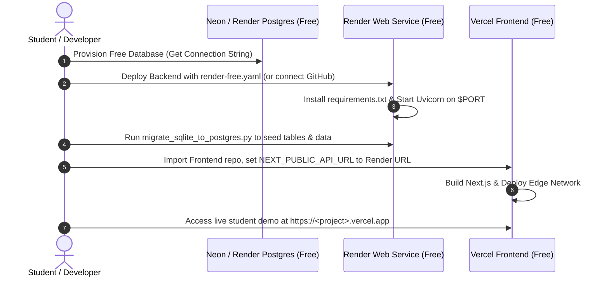

# SmartSched AI — Zero-Cost Student Deployment Guide

**Target Audience:** Students, Evaluators, and Academic Project Teams  
**Target Cost:** \$0.00 / month (100% Zero-Cost Free Tiers)  
**Target Platform:** Vercel (Frontend) + Render / Neon (Backend & Database)

---

## 1. Executive Summary & Cost Analysis

| Component | Cloud Provider | Free Tier Specification | Cost / Month | Potential Incurred Charges (if misconfigured) |
| :--- | :--- | :--- | :---: | :--- |
| **Frontend** | **Vercel** (Hobby Plan) | Unlimited personal projects, 100 GB bandwidth, free SSL, edge caching | **\$0.00** | High bandwidth / commercial team conversion (\$20/seat/mo if upgrading). Hobby tier is strictly free for non-commercial projects. |
| **Backend API** | **Render** (Free Web Service) | 512 MB RAM, 0.1 CPU, 750 free instance hours/month | **\$0.00** | Accidentally selecting `plan: starter` (\$7/mo) or `standard` (\$25/mo). |
| **Database Option A** | **Render Free PostgreSQL** | 1 GB storage, 256 MB RAM, max 100 connections | **\$0.00** | Selecting `plan: standard` (\$20+/mo) or allowing standard paid add-ons. **Note: Render free DB expires after 30 days.** |
| **Database Option B** *(Recommended)* | **Neon.tech Serverless Postgres** | 1 GB storage, 100 CU-hours/month, autoscaling to 2 CU, **does not expire after 30 days** | **\$0.00** | Exceeding 1 GB storage or 100 CU-hours (unlikely for student demos). |

---

## 2. Free-Tier Operational Constraints & Mitigations

### 2.1 Render Free Web Service Spin-Down (Cold Starts)
- **Constraint:** Free web services automatically spin down (sleep) after 15 minutes of inactivity.
- **User Impact:** The first request after idle will take **45–60 seconds** to wake up. Subsequent requests respond instantly in under 100ms.
- **Mitigation:**
  - Inform evaluators that the initial page load may experience a brief cold-start spin-up.
  - Alternatively, use a free ping monitor (e.g., [Cron-job.org](https://cron-job.org) or [UptimeRobot](https://uptimerobot.com)) calling `https://<your-render-app>.onrender.com/api/v1/health` every 10 minutes during your presentation or evaluation week to keep the service awake.

### 2.2 Render PostgreSQL 30-Day Expiration
- **Constraint:** Render's free PostgreSQL instances are automatically deleted **30 days** after creation.
- **Recommended Solution (Neon.tech or Supabase):**
  - Use [Neon.tech](https://neon.tech) (Free Serverless PostgreSQL). It does not expire, provides 1 GB of storage, and works natively by pasting the connection string into Render's `DATABASE_URL` environment variable.

### 2.3 Memory Constraints (512 MB RAM)
- The core CSP Backtracking solver and Genetic Algorithm execute in **< 80 MB RAM** on university workloads (24 variables, 907 domain possibilities).
- Both algorithms comfortably run within Render's 512 MB container limit without triggering Out-Of-Memory (OOM) kills.

---

## 3. Step-by-Step Zero-Cost Deployment Procedure



### Step 1: Provision Free Database
#### Choice 1: Neon Serverless Postgres (Recommended - Never Expire)
1. Sign up for free at [neon.tech](https://neon.tech).
2. Create a project named `smartsched-db`.
3. Copy the pooled connection string:
   ```
   postgresql://<user>:<password>@<ep-name>.neon.tech/neondb?sslmode=require
   ```

#### Choice 2: Render Managed Free Postgres
1. Use `render-free.yaml` directly in Render Blueprints, or create a PostgreSQL database in the Render dashboard and select **Plan: Free**.
2. Render will automatically link the internal connection string via `fromDatabase`.

---

### Step 2: Deploy Backend to Render (100% Free)

1. Sign up or log in to [render.com](https://render.com).
2. Click **New** → **Blueprint**.
3. Connect your GitHub repository `https://github.com/sagarsuryavamshi/SmartSched-AI`.
4. In the blueprint setup, choose the configuration file **`render-free.yaml`**.
5. Render will inspect the file and confirm:
   - Web Service: `smartsched-backend-free` (Plan: **Free**)
   - Database: `smartsched-postgres-free` (Plan: **Free**)
6. Click **Apply**.
7. Once deployed, note your public backend URL:
   `https://smartsched-backend-free.onrender.com`

---

### Step 3: Populate PostgreSQL Database

From your local machine terminal, run the existing migration script pointing to your deployed PostgreSQL database:
```bash
# If using Neon or external Render DB:
export DATABASE_URL="postgresql://<user>:<password>@<host>/<dbname>?sslmode=require"
python backend/scripts/migrate_sqlite_to_postgres.py
```
*Output will verify 6 classrooms, 5 faculty, 3 groups, 10 courses, 25 timeslots, and 27 scheduled assignments migrated with zero foreign-key errors.*

---

### Step 4: Deploy Next.js Frontend to Vercel (100% Free)

1. Sign up or log in to [vercel.com](https://vercel.com) using your GitHub account.
2. Click **Add New...** → **Project**.
3. Select your repository `SmartSched-AI`.
4. In the Project Settings:
   - **Framework Preset:** Next.js
   - **Root Directory:** Edit and select `frontend`
   - **Environment Variables:**
     - Add `NEXT_PUBLIC_API_URL` = `https://smartsched-backend-free.onrender.com/api/v1`
5. Click **Deploy**.
6. In ~60 seconds, your application is live at `https://smartsched-ai.vercel.app` (or your custom `.vercel.app` domain).

---

## 4. Verification & Health Check Checklist

- [ ] **API Health:** Visit `https://<render-url>.onrender.com/api/v1/health` and verify `"status": "healthy"`.
- [ ] **Swagger UI:** Visit `https://<render-url>.onrender.com/docs` to test live endpoints.
- [ ] **Frontend Login:** Open the Vercel URL and sign in with demo accounts:
  - **Admin:** `admin` / `Admin@SmartSched2026` (Full optimization & editing permissions)
  - **Viewer:** `viewer` / `Viewer@SmartSched2026` (Read-only timetable access)
- [ ] **Run CSP Solver:** Execute a Backtracking solve from the Optimization Wizard (verifies 0 hard violations).
- [ ] **Run Genetic Algorithm:** Execute a GA run (verifies stochastic evolutionary search).
- [ ] **Timetable Grid:** View master, student cohort, faculty, and classroom weekly schedules.
